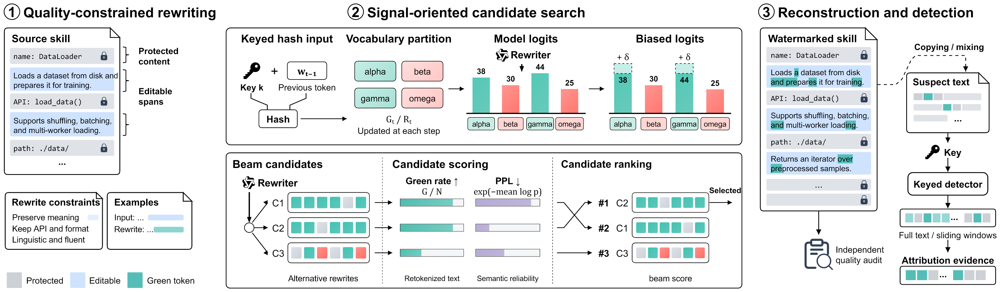
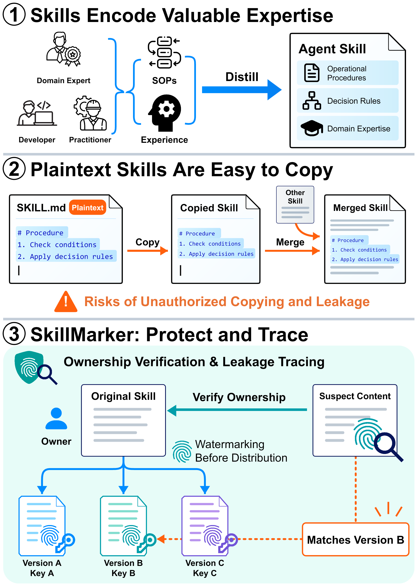

<h1 align="center">SkillMarker</h1>

<p align="center">
  <strong>A KGW-Based Watermarking Method for Agent Skill Ownership Verification</strong>
</p>

<p align="center">
  Alan Tang · Lifeng Wang · Gang Wu · Tao Zhang · Yantao Jia · Xiaofeng Zhu
</p>

<p align="center">
  <a href="https://fuxi-ailabs.github.io/SkillMarker/"></a>
  <a href="https://arxiv.org/abs/2610.15725"></a>
  <a href="https://arxiv.org/pdf/2610.15725"></a>
  <a href="https://alantang7-skillmark.hf.space/"></a>
</p>

## Overview

**SkillMarker** embeds keyed watermarks into agent skill instructions to support
ownership verification and leakage tracing. It combines quality-constrained
rewriting with signal-oriented candidate search: preserve essential content,
explore alternative expressions, and select rewrites with stronger watermark
signals under preservation constraints.

[](assets/method.png)

1. **Quality-constrained rewriting.** Separate protected content from editable prose and constrain rewrites to preserve operational requirements.
2. **Signal-oriented candidate search.** Explore alternative expressions under a KGW watermark bias and rank candidate rewrites.
3. **Reconstruction and detection.** Reassemble the skill, audit its quality, and test suspect text for the keyed signal.

<details>
<summary><strong>Motivation: protecting expertise in reusable skills</strong></summary>

<p align="center">
  <a href="assets/motivation.png"></a>
</p>

</details>

## Interactive demo

**[Project website and instant examples →](https://fuxi-ailabs.github.io/SkillMarker/)**

Compare original and watermarked Skills, inspect precomputed full-document
detection scores, and download the saved files. The two curated examples were
editorially reviewed before scoring; they are demonstrations, not a benchmark.

**[Launch the demo →](https://alantang7-skillmark.hf.space/)**

Upload a complete `SKILL.md` to explore watermark embedding and saved-text
detection. The demo is hosted on Hugging Face Spaces.

## Paper and citation

Read the **[paper on arXiv](https://arxiv.org/abs/2610.15725)** or open the
**[PDF](https://arxiv.org/pdf/2610.15725)** for the method and evaluation.

```bibtex
@misc{tang2026skillmarker,
  title         = {SkillMarker: A KGW-Based Watermarking Method for Agent Skill Ownership Verification},
  author        = {Alan Tang and Lifeng Wang and Gang Wu and Tao Zhang and Yantao Jia and Xiaofeng Zhu},
  year          = {2026},
  eprint        = {2610.15725},
  archivePrefix = {arXiv},
  primaryClass  = {cs.CR},
  url           = {https://arxiv.org/abs/2610.15725}
}
```
